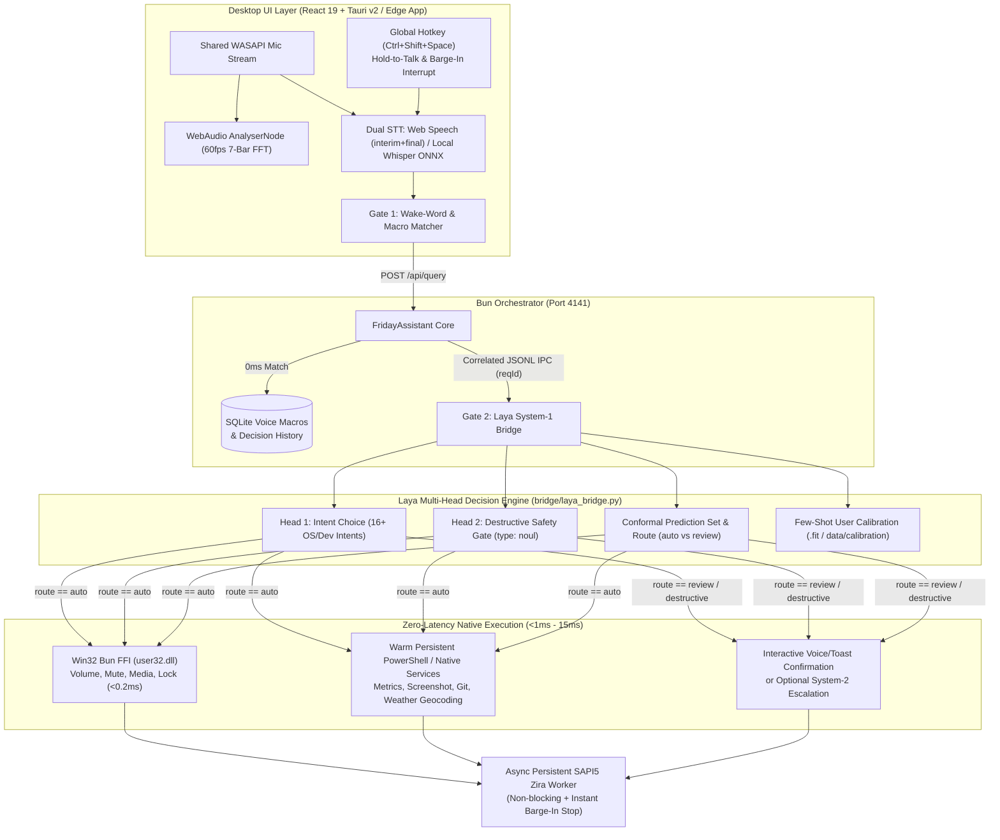

# 🚀 Hey FRIDAY v2.0 — Next-Level Architecture & Improvement Roadmap

> **Project**: Hey FRIDAY (`dr-week/hey-FRIDAY-`)  
> **Companion Benchmark**: [`docs/SIMILAR_PROJECTS.md`](./SIMILAR_PROJECTS.md)  
> **Status**: Actionable Engineering Audit & Phased Implementation Blueprint

---

## 1. Deep Codebase Audit: Bottlenecks & Gaps Identified in v1.0

An end-to-end line-by-line review of the repository revealed **7 high-impact engineering bottlenecks** where the runtime implementation diverges from or under-utilizes the sub-30ms System-1 design:

| # | Component & File Location | Current Implementation | Bottleneck / Risk | Target v2.0 Improvement |
| :-: | :--- | :--- | :--- | :--- |
| **1** | **OS Execution Latency** [`src/services/windows_control.ts`](../src/services/windows_control.ts) | Spawns a cold `powershell -NoProfile -Command` subprocess for every media/volume key (`WScript.Shell.SendKeys`) and system check. | Cold-starting `powershell.exe` on Windows takes **180ms–450ms**, dwarfing Laya's **<30ms** neural decision speed. | Use **`bun:ffi`** direct Win32 calls (`user32.dll` `keybd_event` / `LockWorkStation`) for **<0.2ms** execution, plus a warm persistent PowerShell daemon for CIM/WMI & screenshots. |
| **2** | **TTS Startup Lag & Barge-In** [`src/services/speech.ts`](../src/services/speech.ts) | Spawns a new `powershell` process loading `System.Speech` on every spoken response, and `await this.speech.speak()` blocks HTTP response return. | Blocks HTTP `/api/query` until speech finishes playing (~2–4 seconds) and prevents interrupting (barge-in) mid-sentence. | Persistent `SpeechService` stdin/stdout worker (or async fire-and-forget + `STOP` command) so HTTP returns in **<35ms** while speech plays asynchronously. |
| **3** | **Single-Slot IPC Race Condition** [`src/core/engine.ts`](../src/core/engine.ts) | Uses a single `this.pendingResolver` pointer (`L10`, `L68-L71`, `L92`) without request IDs or a queue. | Concurrent requests overwrite `this.pendingResolver`, causing deadlocks or mismatched responses if two queries arrive close together. | Add monotonically increasing `requestId` correlation (`Map<number, Resolver>`) with per-query timeout and automatic bridge process restart on crash. |
| **4** | **Under-Utilized Laya Capabilities** [`bridge/laya_bridge.py`](../bridge/laya_bridge.py) | Extracts only `answers.intent.choice` from a single question; does not surface `probabilities`, `prediction_set`, `abstain`, `route`, or `noul` safety gates. | Ambiguous speech or background noise that passes the wake gate can trigger false-positive OS actions; no user-trainable `.fit()` loop. | Upgrade schema to multi-head (`intent` choice + `is_destructive` noul + conformal `route` + `confidence`), and expose `/api/calibrate` for few-shot `.fit()`. |
| **5** | **Dynamic City Extraction in Weather** [`src/core/friday.ts`](../src/core/friday.ts) & [`apiRoutes.ts`](../src/server/routes/apiRoutes.ts) | `GET /api/weather` sends `"Hey Friday, do I need an umbrella in Goa today?"`, but `weather_check` ignores the spoken city and queries `prefs.defaultCity` (`"Tokyo"`). | Asking for weather in Goa, London, or Mumbai always returns Tokyo weather unless SQLite preferences are manually mutated. | Extract spoken city entity (or use Open-Meteo Geocoding API / city lookup table) and answer with rain/umbrella advice tailored to the query. |
| **6** | **Simulated CSS Waveform & Wake Gate** [`desktop-ui/src/components/WaveformVisualizer.tsx`](../desktop-ui/src/components/WaveformVisualizer.tsx) & [`useGoogleSpeech.ts`](../desktop-ui/src/hooks/useGoogleSpeech.ts) | `WaveformVisualizer` uses static CSS keyframe animations; `useGoogleSpeech` relies solely on Chromium Web Speech (`en-IN`, `interimResults: false`). | No real-time audio reactivity or interim live transcript preview while speaking; requires internet for Google Chromium speech endpoint. | Connect WebAudio `AnalyserNode` (`getByteFrequencyData`) to the 7 bars, enable `interimResults: true` for live toast preview, and add offline VAD/STT fallback. |
| **7** | **Documentation vs. Code Drift** [`README.md`](../README.md) & [`docs/CRASH_RECOVERY.md`](./CRASH_RECOVERY.md) | `README.md` references MFCC cosine similarity calibration and Tauri v2 build; `CRASH_RECOVERY.md` references `desktop/crash_handler.py`. | New contributors looking for `desktop/crash_handler.py` or Tauri config files (`src-tauri/`) won't find them in the repo yet. | Align documentation with current files and implement the concrete calibration endpoint, macro memory, and Tauri v2 scaffold. |

---

## 2. Target v2.0 System Architecture

---

## 3. Phased Implementation Plan

### Phase 1: Sub-Millisecond Runtime & IPC Hardening (Immediate Quick Wins)
*Goal: Eliminate the 200ms–450ms PowerShell bottleneck, fix IPC concurrency, and make HTTP responses instant.*

- [ ] **1.1 Correlated Async Queue in [`src/core/engine.ts`](../src/core/engine.ts)**:
  - Replace single `pendingResolver` with `requestId` counter and `Map<string, { resolve, reject, timer }>`.
  - Add 5-second timeout and automatic subprocess respawn if `laya_bridge.py` exits unexpectedly.
- [ ] **1.2 Direct Win32 FFI (`bun:ffi`) in [`src/services/windows_control.ts`](../src/services/windows_control.ts)**:
  - Use `bun:ffi` (`dlopen("user32.dll", ...)`) to invoke `keybd_event` (`VK_VOLUME_MUTE = 0xAD`, `VK_VOLUME_DOWN = 0xAE`, `VK_VOLUME_UP = 0xAF`, `VK_MEDIA_NEXT_TRACK = 0xB0`, `VK_MEDIA_PREV_TRACK = 0xB1`, `VK_MEDIA_PLAY_PAUSE = 0xB3`) and `LockWorkStation` in **<0.2ms** without spawning PowerShell.
  - Retain safe cross-platform fallbacks when running tests on Linux/macOS CI.
- [ ] **1.3 Non-Blocking Speech & Barge-In Support in [`src/services/speech.ts`](../src/services/speech.ts)**:
  - Maintain a warm persistent TTS worker or non-blocking speech queue with `stopSpeaking()` cancellation so `/api/query` returns the text response to the UI immediately while Zira speaks, and pressing `Ctrl+Shift+Space` interrupts speech.
- [ ] **1.4 Smart City Geocoding in [`src/services/weather.ts`](../src/services/weather.ts)**:
  - Detect city names in queries (e.g., *"do I need an umbrella in Goa today?"*) via Open-Meteo's free Geocoding API (`https://geocoding-api.open-meteo.com/v1/search?name=...`) with built-in coordinates cache for common cities (Goa, Tokyo, Bengaluru, Mumbai, Delhi, London, New York) and return explicit umbrella advice when `isRaining` or `rainProbability > 40%`.

---

### Phase 2: Next-Gen Laya System-1 Intelligence (`choice` + `noul` + Conformal Routing + Macros)
*Goal: Unlock Laya's full VegaML capabilities and Atticus-style learned voice shortcuts.*

- [ ] **2.1 Multi-Head Schema & Conformal Abstention in [`bridge/laya_bridge.py`](../bridge/laya_bridge.py)**:
  - Expand `decision_questions` to simultaneously evaluate:
    1. `intent` (`type: "choice"`): Primary command intent.
    2. `safety_gate` (`type: "noul"`): *"Does this action delete data, lock the workstation, or disrupt active work?"*
  - Return `confidence`, `predictionSet`, `abstain`, and `route` (`"auto"` vs `"review"`) in [`LayaDecisionResult`](../src/core/types.ts).
- [ ] **2.2 Learned Voice Macros & Custom Calibration in [`src/services/db.ts`](../src/services/db.ts)**:
  - Add a `voice_macros` table in `friday.sqlite` allowing users to map custom trigger phrases (e.g., *"focus mode"*, *"standup prep"*) to multi-step intent sequences that execute in **0ms**.
  - Add `/api/macros` and `/api/history` REST endpoints so the UI or CLI can inspect decision telemetry and train custom phrasing (`agent.fit()`).
- [ ] **2.3 Expanded Developer & OS Intents**:
  - Window management (`window_minimize_all`, `window_snap_left`, `window_snap_right`).
  - Clipboard & quick notes (`clipboard_summarize`, `voice_note_save`).
  - Active Media / Process inspector (`dev_kill_port`, `system_top_processes`).

---

### Phase 3: Real-Time Audio Reactivity & UI Polish (`desktop-ui`)
*Goal: Transform the floating pill into a responsive, hardware-reactive HUD.*

- [ ] **3.1 Real WebAudio Frequency Analyzer ([`WaveformVisualizer.tsx`](../desktop-ui/src/components/WaveformVisualizer.tsx))**:
  - Hook `navigator.mediaDevices.getUserMedia({ audio: true })` into a lightweight `AudioContext` + `AnalyserNode` (`fftSize = 32`) to drive the 7 waveform bars with real-time vocal energy levels, falling back gracefully if mic permission is denied.
- [ ] **3.2 Live Interim Transcripts & Latency Badge ([`useGoogleSpeech.ts`](../desktop-ui/src/hooks/useGoogleSpeech.ts) & [`SpeechToast.tsx`](../desktop-ui/src/components/SpeechToast.tsx))**:
  - Enable `interimResults = true` so the user sees their words appear live as they speak, followed by the sub-30ms Laya execution badge (`⚡ 14ms • system_volume_mute`).
- [ ] **3.3 Hold-to-Talk & Barge-In Shortcut ([`useKeyboardShortcut.ts`](../desktop-ui/src/hooks/useKeyboardShortcut.ts))**:
  - Support both toggle mode and hold-to-talk on `Ctrl+Shift+Space`, plus `Escape` to dismiss/stop speech.

---

### Phase 4: Production Tauri v2 Native Overlay & Offline Whisper/Wake-Word
*Goal: Compile into a ~12MB standalone Windows native binary with zero browser dependency.*

- [ ] **4.1 Tauri v2 Rust Shell (`src-tauri/`)**:
  - Configure `tauri.conf.json` with `transparent: true`, `decorations: false`, `alwaysOnTop: true`, `skipTaskbar: true`.
  - Apply `SetWindowDisplayAffinity(hwnd, WDA_EXCLUDEFROMCAPTURE)` so the floating pill is invisible in screen recordings and Discord/Teams shares.
- [ ] **4.2 100% Offline Audio Pipeline (`openWakeWord` + `sherpa-onnx` / `whisper.cpp`)**:
  - Replace Chromium's cloud-backed `webkitSpeechRecognition` with local ONNX wake-word detection (`openWakeWord` / `Rustpotter`) and int8-quantized Whisper/Moonshine ASR for true air-gapped operation.

---

## 4. Prioritization Matrix (Impact vs. Effort)

| Initiative | Latency Impact | UX / Reliability Impact | Engineering Effort | Priority |
| :--- | :---: | :---: | :---: | :---: |
| **Bun FFI (`user32.dll`) for Volume/Media/Lock** | 🔥 **-350ms** (400ms → <1ms) | High | Low (1 file) | **P0 (Immediate)** |
| **Correlated Request Queue in `LayaEngine`** | Prevents hangs | 🔥 Critical stability | Low (1 file) | **P0 (Immediate)** |
| **Dynamic City Extraction + Umbrella Advice in Weather** | Neutral | 🔥 Fixes Goa/City bug | Low (2 files) | **P0 (Immediate)** |
| **Laya Multi-Head (`noul` safety + confidence/route)** | 0ms overhead | High (Prevents false triggers) | Medium (2 files) | **P1 (High)** |
| **Learned Voice Macros & `/api/history` Telemetry** | 🔥 **0ms** on macros | High (Atticus-style learning) | Medium (3 files) | **P1 (High)** |
| **Live Interim Transcript + WebAudio FFT Waveform** | Feels instantaneous | 🔥 High visual polish | Medium (3 UI files) | **P1 (High)** |
| **Tauri v2 Native Overlay & Offline ONNX STT** | -30MB RAM | High (Air-gapped install) | High (Rust toolchain) | **P2 (Next Milestone)** |
