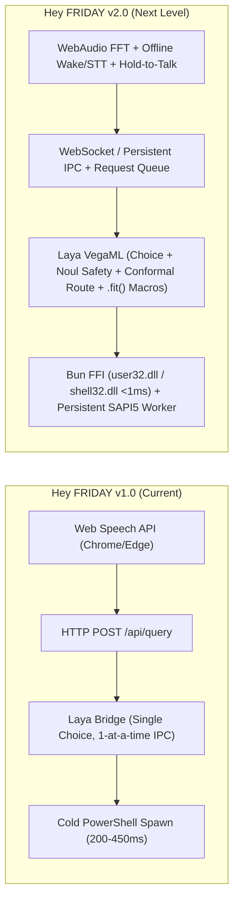

# 🌐 Similar GitHub Projects & Competitive Landscape

> **Project**: Hey FRIDAY (`dr-week/hey-FRIDAY-`)  
> **Scope**: Comparative Architectural Benchmark of Open-Source Desktop Voice Assistants, Semantic Routers, and Offline Audio Pipelines  
> **Engineered by**: Danger Labs

---

## 1. Executive Summary

Most open-source desktop voice assistants fall into one of two extremes:
1. **Heavy Generative LLM Agents** (`Ollama` / `Llama-3` / `OpenAI Realtime`) that incur **800ms–3,500ms** of autoregressive token-generation latency and consume **4GB+ VRAM** just to mute audio or check git status.
2. **Rigid Rule-Based Python Scripts** (`SpeechRecognition` + `pyttsx3` + regex `if/else`) that break easily when a user phrases a command slightly differently.

**Hey FRIDAY** occupies a unique, high-leverage architectural niche: **Non-Autoregressive System-1 Desktop Intelligence** powered by [`NandhaKishorM/laya`](https://github.com/NandhaKishorM/laya) (`<30ms` single-forward-pass classification) coupled with a **Bun + React 19 glassmorphic floating pill overlay**.

By benchmarking the top open-source projects across GitHub, we identify concrete architectural patterns, features, and native integrations to elevate **Hey FRIDAY** to v2.0.

---

## 2. Competitive Matrix: Top Similar GitHub Projects

| Repository | Stars | Primary Stack | Wake-Word & STT | Decision / NLU Engine | TTS Engine | Desktop Shell & UI | Key Strength | Key Limitation vs. Hey FRIDAY |
| :--- | :---: | :--- | :--- | :--- | :--- | :--- | :--- | :--- |
| **[Hey FRIDAY](https://github.com/dr-week/hey-FRIDAY-)** *(Current)* | — | Bun (TS) + Python Bridge + React 19 | Web Speech API (`en-IN`) + Regex Wake Gate | **Laya System-1** (`<30ms` non-autoregressive) | Windows SAPI5 (`Zira`) via PowerShell | Edge `--app` (Tauri v2 target) | Sub-30ms typed routing, zero cloud LLM cost, crash telemetry | Spawns PowerShell per OS command; lacks Tauri native overlay & conformal abstention |
| **[NandhaKishorM/laya](https://github.com/NandhaKishorM/laya)** | ⭐ 36.0k | Python / PyTorch / VegaML | Direct Audio (`laya[audio]`) / Text / Vision | **VegaML System-1** (`choice`, `score`, `noul`, conformal `route`) | N/A (Decision Engine) | Library / Headless | Conformal prediction sets, `abstain`/`unbound` OOD detection, few-shot `.fit()` | Core engine only — needs a desktop host & OS automation layer like Hey FRIDAY |
| **[vllm-project/semantic-router](https://github.com/vllm-project/semantic-router)** | ⭐ 6.5k | Rust + Python + Go | N/A | Embedding + Classifier Mixture-of-Models router | N/A | Server Gateway | Fast semantic routing between fast local actions and heavy LLMs | Built for cloud/server clusters rather than lightweight Windows desktop overlays |
| **[aurelio-labs/semantic-router](https://github.com/aurelio-labs/semantic-router)** | ⭐ 4.1k | Python | N/A | Vector embedding similarity routing | N/A | Library | Simple declarative `Route` definitions and dynamic slot extraction | Requires embedding index calculation; lacks calibrated conformal abstention |
| **[Priler/jarvis](https://github.com/Priler/jarvis)** | ⭐ 3.0k | **Rust + Tauri** + Vite (Svelte) | `Rustpotter` / `Porcupine` + `Vosk-rs` | Custom pattern matching | Silero / WinRT | **Tauri Native Desktop App** | 100% offline Rust + Tauri binary, native audio capture (`pvrecorder`) | Weak NLU (no System-1 neural router); primarily Russian language support |
| **[SaarthurR/atticus-mac](https://github.com/SaarthurR/atticus-mac)** & **[FindlayHi/atticus-windows](https://github.com/FindlayHi/atticus-windows)** | ⭐ 858 / 33 | C# (.NET 10) / Swift + Python | Local Whisper + Hold-to-Talk (`Ctrl+Alt+Space`) | Fast instant-command bypass + Claude Haiku escalation | Native OS TTS | Native Glass Overlay | **Learned Shortcuts** (runs once via AI, replays at 0ms forever), UI Automation, screen vision | Requires paid Claude Pro/Max subscription for complex queries |
| **[fluxions-ai/vui](https://github.com/fluxions-ai/vui)** | ⭐ 787 | C / Python / WebRTC | Local Whisper ASR | Local LLM | **Vui Nano** (219M params on CPU, streaming) | Web / Native | Ultra-fast dependency-free C/CPU conversational TTS with voice cloning | High LLM latency compared to System-1 deterministic command routing |
| **[Picovoice/picovoice](https://github.com/Picovoice/picovoice)** | ⭐ 706 | C / Rust / Python / JS | **Porcupine** (Wake Word) + **Cobra** (VAD) | **Rhino** (Speech-to-Intent direct inference) | Orca | Cross-platform SDK | Direct Speech-to-Intent (`Rhino`) without intermediate text transcription | Proprietary commercial API keys and strict free-tier limits |
| **[DO0OG/Ari-VoiceCommand](https://github.com/DO0OG/Ari-VoiceCommand)** | ⭐ 22 | Python (Windows) | OpenWakeWord + Local Whisper | **Custom Local Decision Engine** (`choice` + `noul` safety gate) + Ollama + **MCP** | CosyVoice3 / Edge TTS | Windows Character Overlay | Combines fast System-1 local routing with **SafetyChecker** (`noul`), plugins & MCP | Heavy Python runtime footprint compared to Bun + Tauri |
| **[gyng/widgetsack](https://github.com/gyng/widgetsack)** | ⭐ 15+ | Rust + Tauri + TypeScript | N/A | N/A | N/A | **Tauri Win32 DWM Overlay** | Native Win32 media/volume/hardware hooks and `Win+D` desktop layering | Pure visual widget; lacks voice pipeline and intent intelligence |

---

## 3. Deep-Dive Architectural Takeaways per Category

### A. System-1 Decision & Semantic Routing (`NandhaKishorM/laya`, `DO0OG/Ari-VoiceCommand`)
1. **Conformal Abstention & Two-Tier Escalation (`laya` v0.5+)**:
   - Currently, [`bridge/laya_bridge.py`](../bridge/laya_bridge.py) only reads `res["answers"]["intent"]["choice"]` using a single `choice` question.
   - Modern `laya` (`laya.Agent(vegaml=True)`) outputs:
     - `prediction_set`: e.g., `["system_volume_mute"]` (1 item = high certainty; >1 items = ambiguous).
     - `abstain`: boolean flag calibrated to keep error rate under 10%.
     - `unbound`: out-of-distribution detector (when the user says random chatter not matching any command valley).
     - `route`: `"auto"` vs `"review"`.
   - **Lesson for Hey FRIDAY**: Never blindly execute when `route == "review"` or `abstain == True`. Gate OS actions on `route == "auto"`, and either ask for confirmation or escalate complex queries to an optional System-2 local/cloud model.

2. **Multi-Head Parallel Decisions (`choice` + `noul` + `score`)**:
   - `laya` evaluates multiple decision questions in **the exact same single forward pass** with zero extra latency.
   - `Ari-VoiceCommand` uses a binary `noul` primitive (`"Is this a destructive or irreversible system state change?"`) alongside the primary intent `choice`.
   - **Lesson for Hey FRIDAY**: Add a `destructive_risk` (`type: "noul"`) and `volume_delta` (`type: "score"`) head to `decision_questions` in [`bridge/laya_bridge.py`](../bridge/laya_bridge.py) so `"empty recycle bin"` or `"lock computer"` automatically carries a calibrated safety check.

3. **Direct Audio-to-Intent (`laya[audio]`) & Personalized Calibration (`.fit()`)**:
   - `laya` supports `agent.predict(audio=wave, questions=questions, sampling_rate=16000)` and 9-second local calibration via `agent.fit(csv_rows, questions=questions)` + `agent.save_calibration("data/calibration/")`.
   - **Lesson for Hey FRIDAY**: Users can teach Hey FRIDAY custom phrasing or shortcuts in seconds, saving calibrated heads locally in `data/calibration/` so accuracy climbs from ~84% to **96%+**.

---

### B. Desktop Interaction & Learned Shortcuts (`FindlayHi/atticus-windows`, `SaarthurR/atticus-mac`)
1. **Hold-to-Talk vs. Passive Wake-Word Dual Mode**:
   - `atticus-windows` supports holding `Ctrl+Alt+Space` (or `Ctrl+Shift+Space` in Hey FRIDAY) to speak immediately without saying the wake word, releasing the key to execute, and pressing `Esc` to cancel.
   - Pressing the shortcut *while* the assistant is speaking acts as an instant **barge-in / stop speaking** interrupt.
2. **Learned Shortcuts / Voice Macros**:
   - When a user defines a routine (`"When I say focus mode, mute audio, check git status, and lock screen"`), `atticus` stores the macro in local storage and executes it deterministically at 0ms on future runs.
3. **Screen-Share Invisible Overlay & UI Automation**:
   - Setting the Win32 window affinity flag `SetWindowDisplayAffinity(hwnd, WDA_EXCLUDEFROMCAPTURE)` hides the floating pill from OBS, Discord screen shares, Teams meetings, and Hey FRIDAY's own screenshots!

---

### C. Native Windows Performance & Tauri v2 (`Priler/jarvis`, `gyng/widgetsack`)
1. **Eliminating Per-Command PowerShell Spawning**:
   - In Hey FRIDAY's current [`src/services/windows_control.ts`](../src/services/windows_control.ts) and [`src/services/speech.ts`](../src/services/speech.ts), every command spawns a cold `powershell.exe -NoProfile -Command ...` process. On Windows, spawning `powershell.exe` takes **180ms–450ms**, which bottlenecks Laya's **<30ms** neural inference!
   - **Lesson for Hey FRIDAY**:
     - Use **Bun FFI (`bun:ffi`)** to call `user32.dll` (`keybd_event` / `SendInput`, `LockWorkStation`) and `shell32.dll` (`SHEmptyRecycleBinW`) directly in **<0.2ms**!
     - Or maintain a single persistent background PowerShell / C# worker pipe (just like [`LayaEngine`](../src/core/engine.ts)) for SAPI5 speech synthesis and WMI/CIM metrics so TTS starts in **<10ms**.
2. **True WebAudio AnalyserNode Waveform**:
   - Currently, [`WaveformVisualizer.tsx`](../desktop-ui/src/components/WaveformVisualizer.tsx) animates 7 CSS bars via static CSS keyframes when `isListening` is true.
   - Using the browser's `AudioContext` + `AnalyserNode.getByteFrequencyData()` on the non-exclusive mic stream drives the 7 bars with actual real-time voice frequency energy at 60fps.

---

## 4. Summary of Strategic Opportunities for Hey FRIDAY

